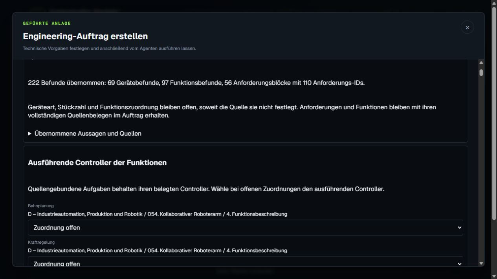

# Gemeinsame Fahrzeug- und Robotik-Nachprüfung

Status: **COMPLETED**. Beide vollständigen nativen Wizard-Abnahmen und das verpflichtende vollständige Release-Gate bestehen. Genau das geprüfte Image ist produktiv ausgeliefert und unabhängig auf Imageidentität, Gesundheit, Dateihashes, UI und betroffene Funktion geprüft.

## Korrektur und Abstimmung

Die Umsetzung wurde mit dem Chat „NIS starten“ abgestimmt. Dort liegen die gemeinsame Parserkorrektur, Fahrzeugprüfung, Release-Prüfung und anschließende Lieferung. Dieser Chat hat die Änderung unabhängig geprüft und die vollständige Robotikprüfung durchgeführt. Beide echten Qwen-Läufe erfolgten seriell auf demselben unveränderten Kandidaten. Während des Release-Gates erfolgen keine zusätzlichen Native-Auswertungen oder Änderungen an Anwendung und Tests.

Die Kommunikationshandlung „mit externen Systemen kommunizieren (Backend, OTA‑Server, Diagnosegeräte)“ wird jetzt als Funktion übernommen. Kommunikationsverben werden vor Hardwarebegriffen erkannt; ausdrücklich benannte Server, Gateways und zusammengesetzte Controllerbezeichnungen bleiben Hardware. Anforderungen behalten Vorrang. Der Zwei-Dateien-Patch hat 30 gezielte Backend-Regressionsprüfungen und 114 gezielte Frontendtests bestanden. Die unabhängige Patchprüfung hat keine weiteren Befunde ergeben.

Der gemeinsame Kandidat ist `sha256:eaab97030ad994dc8a00e8fc6f38ada67c38e915e316deda63d231902843537b`, Anwendungsquelle `be82385a9aab125ae8a296d1f1df1698551e44241bf3d1c1984dc7837ecff897`, Basis-Commit `70f0c160bc4f08bd23437f6b3c175523d1e5859c`. Die unabhängige Laufzeitprüfung bestätigt Image, Quelle, Testisolation und alle 16 eingefrorenen Dateien.

## Vollständige Originaldateien im Wizard

| Prüfung | Fahrzeug | Robotik |
| --- | --- | --- |
| Original | Fahrzeug komplett.txt | D_INDUSTRIAL_ROBOTICS_054_063.md |
| Unveränderte Zeichen | 19.088 | 63.705 |
| Tatsächliche Qwen-Abschnitte | 14 | 25 |
| Vollständige Einzelanforderungen | 168 | 110 |
| Funktionen | 38 | 97 |
| Gerätegruppen / benannte Instanzen | 6 / 5 | 68 / 1 |
| Anforderungsblöcke | 31 | 56 |
| Normale strukturierte Übernahme | 80 von 80 Befunden | 222 von 222 Befunden |
| Erforderliche Quelleneinheiten vollständig | 73 | 216 |

Fahrzeug-SHA256: `86865975c689643d9b07ea73e21d68fa6f4a3a8770402ffb537dba2d7ecdf4d7`.
Robotik-SHA256: `8fc201a55e8b0afeb7b708ac70abd0c72a7b25eb17d90fceca71d80a291f3cef`.

Die Dateien wurden über den normalen Dateidialog hochgeladen und mit dem normalen Modellbutton ausgewertet. Tatsächliche UI-Befunde wurden mit vollständigen Quellenzeilen, Rollen, Kontexten, sämtlichen Anforderungstexten und Funktionsbeschreibungen verglichen und über den normalen Übernahmebutton übernommen. Es gab keine manuelle Änderung von Parserergebnissen oder Modellobjekten.

Beim Fahrzeug bleiben alle fünf Domänencontroller und ihre unterschiedlichen Aufgaben erhalten. Die Kommunikationshandlung ist korrekt `FUNCTION/OTHER`. NIS ordnet 22 eindeutig quellengebundene Funktionen selbst zu, darunter vier unterschiedliche ADC-Aufgaben. Ungeklärte Angaben bleiben als Fragen erhalten.

Bei Robotik bleiben alle zehn Profile mit vollständigen Funktions- und Assurance-Absätzen erhalten. Testfälle und logische Dienste werden nicht zu physischen Geräten. Die Robotikprüfung besteht aus 19 Übernahmeprüfungen und acht zusätzlichen Fragefeldprüfungen. 68 unbewiesene Mengen, 34 Gerätearten, 97 unbewiesene Funktionsausführer und der Hauptrechneranschluss bleiben offen; die Modellübernahme bleibt entsprechend gesperrt. Das ist eine erhaltene Quellenentscheidung und keine fehlende Dokumentauswertung. Die angehängte Originaldatei und die leere Beschreibung sind unverändert.

Registrierte Tool-Audits bestätigen je einen erfolgreichen Dokumentaufruf, keine betroffenen Modellobjekte und neun weiterhin leere Workflowstufen. Diese Abnahme belegt vollständige Dokumentauswertung und strukturierte Übernahme. Ein tatsächlich ausgeführtes Robotikmodell, ein Robotik-Neunstufenlauf oder ein Safety-Nachweis wird damit nicht behauptet. Der zusätzlich beauftragte produktive Fahrzeugworkflow und spätere HMI-Eingaben werden getrennt im Chat „NIS starten“ nachgewiesen.

## Nachweise, Release-Prüfung und Produktivlieferung

Robotik: `native-acceptance.json` enthält den Hashindex der unveränderten PASSED-Nachweise. Ergänzend liegen `native-verification.json`, `native-proposal-completeness.json`, `native-classification-review.json`, `native-question-completeness.json`, beide Tool-Audits und `native-handoff-verified.png` vor. Eine optionale zusätzliche Screenshotaktion schloss den bereits geprüften Dialog per Escape; alle erforderlichen Feldwerte und der Haupt-Screenshot waren zuvor gesichert. Ein frischer nachträglicher Audit besteht ebenfalls. Einzelheiten stehen in `native-optional-screenshot-note.json`.

Fahrzeug: `docs/implementation-workloads/document-clarification-repair-20261016/native-be82385-20261017/` enthält die native Übernahme-, Semantik- und Auditnachweise. Der eigene temporäre Robotik-Tab ist geschlossen; Nutzertabs blieben unverändert. Der Eigentümer hat den gemeinsamen Teststack nach beiden gesicherten Abnahmen entfernt.

Offizielle neue Release-Quittung: `backend/test-output/release-gates/communication-actions-full-release-20261017/b53e295b15bd/receipt.json`, Status **PASS**, alle sieben Prüfbereiche mit Exitcode 0. Das Prüfmanifest ist `3d835d420107b71fb9c4f29b862eda8e2a9f6993a150de92e4a879812ee9de79`. 28 Speichertests, TypeScript, 673 Frontendtests, 22.082 Backendtests und 56 Untertests sowie alle 119 Browserfälle bestehen. Im Backend gab es zwei übersprungene Tests und eine bestehende Feldnamenwarnung. Der vollständige Backendlauf dauerte 1.805,41 Sekunden; der Browserlauf 52,6 Minuten.

Der kleine und der große HTTP-Auftrag haben ebenfalls bestanden. Die unabhängige Nachweisprüfung (`http-evidence-independent-review.json`) bestätigt 6 von 6 beziehungsweise 766 von 766 bewertete Routen ohne fehlgeschlagene oder unbewertete Route und ohne fehlende Transportbeobachtungen. Der große Auftrag umfasst 594 erforderliche Transportnachrichten und 1.169 erforderliche Transportsignale. 59 interne Statusnachrichten mit 235 Signalen sind ausdrücklich als `INTERNAL_STATE_NOT_ROUTED` vom Transportumfang ausgenommen; daraus folgt kein Nachweis ihrer funktionalen Beobachtung oder Timing-Freigabe. Kapazität, Preflight und Intelligence enthalten dokumentierte Warnpfade; der Transportkonformitäts-PASS ist keine Safety-Freigabe.

„NIS starten“ hat genau dieses geprüfte Image über `scripts/release-and-deploy.py --receipt` mit der vollständigen neuen PASS-Quittung ausgeliefert. Der tatsächliche Auslieferungslog ist `docs/implementation-workloads/document-clarification-repair-20261016/followup-communication-actions/delivery.log`, Ergebnis `DEPLOYED`, Exitcode 0. Die historische Quittung der vorherigen Produktionsversion wird nicht als Nachweis für diese neue Korrektur verwendet.

Die anschließende unabhängige Produktionsprüfung dieses Chats besteht ebenfalls:

- `production-identity-verification.json`: laufendes `NetworkIS` entspricht exakt Image `eaab97030ad994dc8a00e8fc6f38ada67c38e915e316deda63d231902843537b`, Quelle `be82385a9aab125ae8a296d1f1df1698551e44241bf3d1c1984dc7837ecff897`; Container gesund, Dienst bereit, alle 16 eingefrorenen Dateien hashgleich.
- `production-ui-verification.json`: frischer Wizard-Start im ursprünglichen Robotikprojekt auf Port 13500; Frontend und Backend zeigen denselben Build, Python engine ist bereit, der Technologiekatalog ist geladen und Beschreibung sowie Dateiupload sind zugänglich. `production-ui.png` sichert die Ansicht.
- `production-functional-verification.json`: reine Originalquellen-Parserprobe im tatsächlich laufenden Produktivimage bestätigt 216 erforderliche Quelleneinheiten, 68 Gerätegruppen, eine ausdrücklich benannte Instanz, 97 Funktionen und alle 110 vollständigen Anforderungen. Die 50 deterministischen Anforderungsblöcke und die 56 nativen Anforderungsblöcke enthalten dieselben vollständigen Einzelanforderungen; ihre Gruppierung muss nicht identisch sein.

Die Produktionsprobe hat keine SQL-Tests, neue Qwen-Inferenz oder Modelländerung ausgeführt. Die vollständige echte Qwen-Dateiabnahme und normale strukturierte Übernahme sind bereits auf demselben unveränderlichen Image belegt. Der eigene temporäre Produktiv-Prüftab wurde nach Export geschlossen; Nutzertabs blieben unverändert (`production-tab-cleanup.json`). Der gesonderte produktive Fahrzeuglauf mit späteren HMI-Eingaben bleibt beim Partnerchat und ist nicht Teil dieser Originaldatei-Abnahme.

